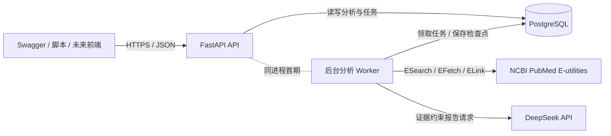
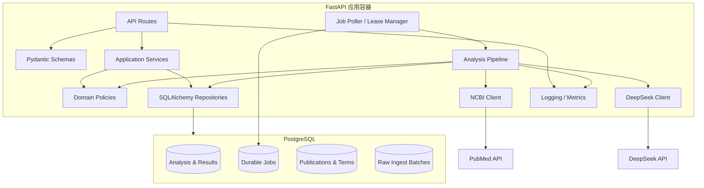
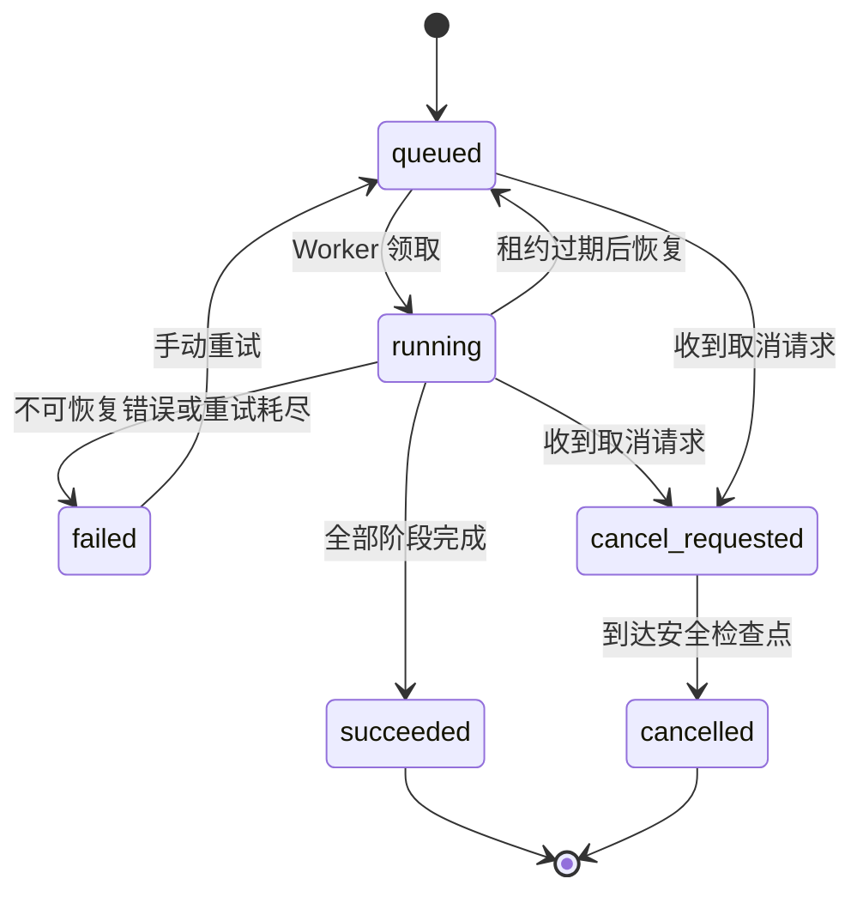
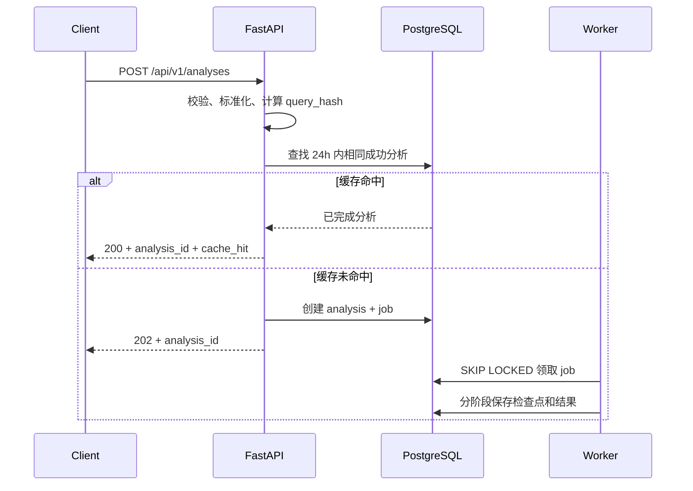
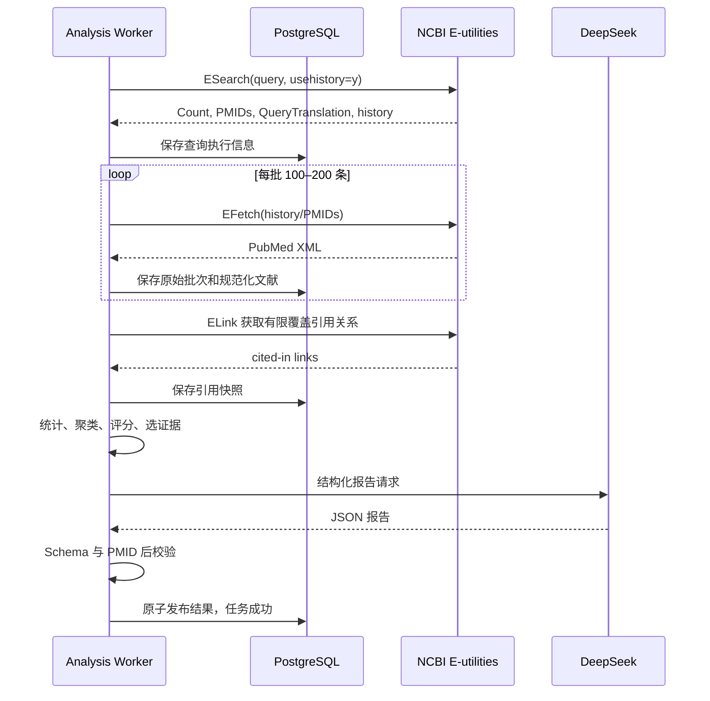
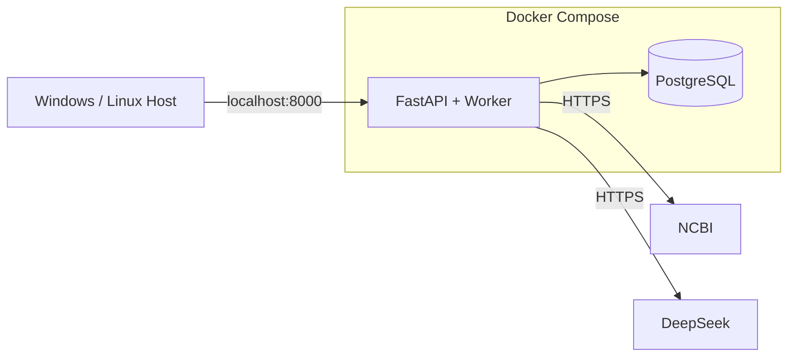

# PubMed 科研情报分析 Demo — 架构文档

| 项目 | 内容 |
| --- | --- |
| 文档版本 | v1.0 |
| 文档日期 | 2026-10-12 |
| 架构阶段 | 后端 MVP |
| 主要技术 | Python、FastAPI、PostgreSQL、SQLAlchemy、Alembic |

## 1. 架构目标

本架构面向单机或单实例 Demo，优先保证：

1. 真实数据可追溯，统计口径可解释。
2. 长耗时任务不阻塞 HTTP 请求。
3. PubMed 与 DeepSeek 故障可诊断、可重试、可降级。
4. 任务和分析结果在服务重启后不丢失。
5. 模块边界足够清晰，未来可以替换为独立 Worker、Redis/Celery 和 PostgreSQL 集群，而不改动 API 契约。

## 2. 架构原则

- **证据优先**：AI 只总结系统提供的证据，不作为文献统计的事实来源。
- **写入幂等**：以 PMID、查询哈希和阶段检查点防止重复写入。
- **显式缺失**：未知值保存为 `NULL/unknown`，不伪造为零或默认国家。
- **外部服务隔离**：PubMed、DeepSeek 均通过独立端口适配器访问。
- **任务可恢复**：进度、租约和重试次数存入 PostgreSQL。
- **配置外置**：密钥、模型、限流、样本上限和保留期均通过环境变量配置。
- **先单体后拆分**：首期采用模块化单体，避免为 Demo 引入不必要的基础设施。

## 3. 系统上下文



首期 API 与 Worker 运行在同一 Python 服务进程中，但通过应用服务接口和数据库任务表解耦。未来拆分 Worker 时，不改变业务层和外部 API。

## 4. 容器与组件



### 4.1 API 层

职责：HTTP 参数校验、状态码、分页、错误映射、可选服务 API Key 校验和 OpenAPI 描述。API 层不直接调用 PubMed 或 DeepSeek。

### 4.2 应用服务层

协调创建、复用、取消、重试和删除分析。负责事务边界，不包含 HTTP 细节。

### 4.3 领域策略层

包含可独立测试和版本化的纯业务逻辑：

- 查询参数标准化与哈希。
- 发表日期归一化。
- 国家/地区解析。
- 词项权重与同义词合并。
- 主题聚类。
- 代表性评分。
- 报告证据选择与报告后校验。

### 4.4 基础设施层

包括 SQLAlchemy Repository、NCBI Client、DeepSeek Client、时钟、限流器和日志实现。通过 Python Protocol/抽象接口注入应用层。

## 5. 推荐项目结构

```text
app/
├── main.py
├── api/
│   ├── dependencies.py
│   ├── errors.py
│   └── v1/
│       ├── analyses.py
│       └── health.py
├── application/
│   ├── analyses.py
│   ├── jobs.py
│   └── dto.py
├── domain/
│   ├── query.py
│   ├── ranking.py
│   ├── regions.py
│   ├── topics.py
│   └── reports.py
├── infrastructure/
│   ├── db/
│   │   ├── models.py
│   │   ├── repositories.py
│   │   └── session.py
│   ├── ncbi/
│   │   ├── client.py
│   │   └── parser.py
│   └── deepseek/
│       ├── client.py
│       └── schemas.py
├── worker/
│   ├── poller.py
│   ├── pipeline.py
│   └── stages.py
├── core/
│   ├── config.py
│   ├── logging.py
│   ├── security.py
│   └── telemetry.py
└── tests/
    ├── unit/
    ├── integration/
    └── e2e/
alembic/
docs/
docker-compose.yml
Dockerfile
pyproject.toml
.env.example
```

## 6. 任务执行架构

### 6.1 为什么不在请求中同步执行

一次分析可能涉及多批 EFetch、ELink、文本分析和一次 DeepSeek 调用，持续数十秒到数分钟。HTTP 请求只负责创建任务，立即返回分析 ID；客户端通过查询接口读取状态。

### 6.2 PostgreSQL 持久化任务队列

首期不引入 Redis/Celery。Worker 定期执行如下流程：

1. 在短事务中使用 `SELECT ... FOR UPDATE SKIP LOCKED` 领取一个 `queued` 或租约过期的任务。
2. 将任务更新为 `running`，写入 `lease_owner`、`lease_expires_at` 和心跳时间。
3. 事务提交后执行一个阶段。
4. 阶段完成后保存结果和检查点，再进入下一阶段。
5. Worker 定期续租；异常退出后，其他 Worker 可在租约过期后重新领取。
6. 每个阶段使用确定性唯一键或 UPSERT，确保重复执行安全。

首期默认只启用一个 Worker、最多两个外部分析并发。即使启动多个进程，行锁和租约也避免同一任务被同时执行。

### 6.3 状态机



任务总状态与执行阶段分离。建议阶段枚举：

1. `searching`：ESearch。
2. `fetching_metadata`：EFetch。
3. `parsing`：XML 解析和规范化。
4. `enriching`：ELink、国家解析。
5. `aggregating`：年份、地区、词项统计。
6. `clustering_topics`：研究方向。
7. `ranking`：近五年代表性评分。
8. `generating_report`：DeepSeek 或模板报告。
9. `finalizing`：一致性校验和发布结果。

### 6.4 进度计算

进度不是按阶段等权。默认建议：

| 阶段 | 区间 |
| --- | --- |
| 检索 | 0–5% |
| 元数据抓取与解析 | 5–45% |
| 丰富 | 45–60% |
| 聚合与主题分析 | 60–78% |
| 排名 | 78–86% |
| 报告 | 86–97% |
| 最终校验 | 97–100% |

阶段内依据批次数更新。进度只单调增加，不代表严格时间比例。

## 7. 主要调用时序

### 7.1 创建与缓存复用



### 7.2 分析流水线



## 8. API 设计

### 8.1 通用约定

- 基础路径：`/api/v1`。
- 数据格式：UTF-8 JSON。
- 时间：ISO 8601 UTC，字段类型为带时区时间戳。
- ID：UUID，由应用生成。
- 分页：游标优先；Demo 可先使用 `page`/`page_size`，最大 100。
- 幂等：创建分析可接受可选 `Idempotency-Key`；服务端查询哈希仍负责业务去重。
- 错误：统一 RFC 7807 风格 `application/problem+json`。

错误示例：

```json
{
  "type": "https://demo.local/problems/upstream-rate-limited",
  "title": "PubMed 请求受到限流",
  "status": 503,
  "code": "PUBMED_RATE_LIMITED",
  "detail": "稍后可重试",
  "retryable": true,
  "correlation_id": "..."
}
```

### 8.2 创建分析

`POST /api/v1/analyses`

```json
{
  "query": "CAR-T therapy solid tumors",
  "start_year": 2022,
  "end_year": 2026,
  "languages": ["eng"],
  "publication_types": [],
  "sort": "relevance",
  "metadata_limit": 2000,
  "abstract_limit": 500,
  "report_evidence_limit": 40,
  "force_refresh": false
}
```

新任务响应：

```json
{
  "analysis_id": "uuid",
  "status": "queued",
  "cache_hit": false,
  "status_url": "/api/v1/analyses/uuid"
}
```

### 8.3 结果发布规则

- 分析未成功时，结果端点返回 `409 ANALYSIS_NOT_READY`，并附当前阶段。
- 统计中间结果可写入临时/版本行，但仅当 `analysis.status=succeeded` 后对普通读取端点可见。
- 报告降级不意味着分析失败；应返回 `succeeded` 和 `ai_status=degraded`。

## 9. PubMed 集成

### 9.1 端点职责

| E-utility | 用途 |
| --- | --- |
| ESearch | 总命中量、PMID、历史游标、QueryTranslation |
| EFetch | 完整 citation XML、摘要、作者、单位、MeSH、关键词 |
| ELink | PubMed 可见引用/被引关系，作为低置信影响力信号 |
| ESummary | 非必需；未来轻量列表查询可使用 |

### 9.2 请求策略

- 基础 URL：`https://eutils.ncbi.nlm.nih.gov/entrez/eutils/`。
- 请求携带 `tool`、`email` 和服务端 `api_key`。
- 应用级令牌桶限速为 8 req/s。
- EFetch 每批建议 100–200 篇；大 ID 集合使用 POST 或 History Server。
- 外部响应先记录批次校验信息，再解析并 UPSERT。
- 解析器按 PubMed XML 结构编写，不从 HTML 页面抓取。

### 9.3 重试规则

- 可重试：网络超时、连接重置、429、部分 5xx。
- 不可重试：无效参数、认证失败、解析确定性失败。
- 使用指数退避加随机抖动，并遵守 `Retry-After`。
- 默认最多 3 次尝试；耗尽后将任务标记为可重试失败。

### 9.4 数据限制

- PubMed ESearch 对可直接取回的结果集合存在边界；本 Demo 只分析配置上限内样本。
- Affiliation 是可选自由文本，国家统计是推断值。
- Cited by 覆盖不完整，只能作为一个低置信信号。
- 新记录可能尚无 MeSH，必须支持 TF-IDF 回退。

## 10. 分析算法

### 10.1 查询标准化

哈希输入由以下字段组成：

- 去除首尾和重复空白后的 `query`，保留 PubMed 语法语义。
- 排序后的语言和文献类型。
- 年份、排序方式和各分析上限。
- 算法配置版本。

使用稳定 JSON 序列化后计算 SHA-256。`force_refresh` 不进入哈希。

### 10.2 国家/地区解析

1. 取第一作者首个单位原文。
2. 依次匹配标准国家名称、ISO 别名、常用缩写和受控机构/城市词典。
3. 邮箱后缀只能作为辅助信号，不可单独高置信判定。
4. 保存 `country_code`、`confidence`、`rule_id` 和解析器版本。
5. 无可靠匹配则为未知。

首期不使用 LLM 判断国家，以保证确定性和可测试性。

### 10.3 主题词和词云

使用 Major MeSH、普通 MeSH、作者关键词及补充 NLP 术语，分别赋权 3/2/1/可配置低权重。保存词项来源，结果可解释。

### 10.4 研究方向

优先方案：

1. 构建文献—MeSH 二部关系。
2. 投影为加权 MeSH 共现图。
3. 过滤低频词和弱边。
4. 使用稳定的社区发现算法生成 5–8 个簇。
5. 为每簇选取加权中心词和代表文献。
6. DeepSeek 根据这些固定事实生成中文名称和 1–2 句总结。

当有 MeSH 的文献占比低于配置阈值时，使用标题/摘要 TF-IDF 向量和固定随机种子的聚类算法。每个分析保存算法、参数、随机种子和版本。

### 10.5 代表性评分

各分项归一化到 `[0, 1]`：

- `relevance_score`：来自 PubMed 返回顺序的衰减分数或可复现排名归一化。
- `citation_score`：PubMed 可见被引数在候选集内的对数变换百分位。
- `recency_score`：近五年范围内的单调时间衰减。
- `publication_type_score`：基于配置表，例如系统综述/Meta 分析、临床试验等。
- `mesh_match_score`：查询映射主题与文献 Major MeSH/MeSH 的匹配比例。

缺失值不直接填零。按可用分项重新归一化权重，同时返回 `effective_weights` 和 `missing_signals`。

## 11. DeepSeek 集成

### 11.1 接口配置

- Base URL：`https://api.deepseek.com`。
- 密钥：`DEEPSEEK_API_KEY`。
- 模型：`DEEPSEEK_MODEL`，默认 `deepseek-flash`。
- 使用 OpenAI 兼容客户端或直接 HTTP 客户端。
- 模型名始终配置化，避免供应商升级造成硬编码失效。

### 11.2 输入控制

发送内容仅包括：

- 聚合统计和统计口径。
- 主题簇名称候选、代表术语和 PMID。
- 30–50 篇精选文献的 PMID、标题、MeSH 和截断摘要。
- 明确的 JSON 输出结构和禁止事项。

不发送密钥、作者邮箱、无关单位详情或整库数据。

### 11.3 结构化输出

要求 JSON 输出，服务端使用 Pydantic 严格校验：

- 五个固定章节。
- 每章正文与 `evidence_pmids`。
- 局限说明。
- 生成模式和模型名。

后校验必须确认所有 PMID 都存在于证据集，精确数字能在输入统计中找到。失败时允许一次修复请求；仍失败则使用确定性模板报告。

### 11.4 错误策略

- 429、500、503 和网络错误：有限指数退避。
- 400、401、402、422：不重试，记录可诊断错误但不泄露响应敏感信息。
- 应用级 DeepSeek 并发默认 2。
- 设置连接、首字节和总时限；超时后降级，不阻塞整个分析结果。

## 12. 缓存与一致性

### 12.1 三层复用

1. **分析结果缓存**：相同查询哈希 24 小时内复用成功分析。
2. **文献缓存**：PMID 全局去重；可按数据新鲜度决定是否重新获取。
3. **外部响应审计**：保存批次元数据和压缩原始 XML，默认 30 天。

### 12.2 发布一致性

统计结果按 `analysis_id + algorithm_version` 写入。最终阶段在一个短事务中：

1. 校验必要结果存在。
2. 写入结果版本。
3. 将分析和任务标记为成功。

客户端不会看到一半旧、一半新的结果。

## 13. 安全设计

- `.env` 不进入版本控制，只提供 `.env.example`。
- 真实密钥不保存到数据库，不写入日志和异常堆栈。
- 首期服务默认绑定 `127.0.0.1`。
- 可选 `SERVICE_API_KEY` 通过 `X-API-Key` 校验，并使用常量时间比较。
- CORS 只允许配置中的来源；未配置前端时默认关闭跨域。
- 对查询长度、年份范围、样本上限、分页和并发设置硬限制。
- SQL 全部通过 SQLAlchemy 参数绑定，不拼接用户输入。
- PubMed 高级表达式是传给 NCBI 的数据，不作为本地 SQL 或命令执行。
- 返回 NCBI 数据时保留来源及免责声明入口。

## 14. 可观测性

### 14.1 日志

JSON 日志包含：

- `timestamp`、`level`、`service`、`environment`。
- `correlation_id`、`analysis_id`、`job_id`。
- `stage`、`duration_ms`、`attempt`。
- 上游名称、HTTP 状态和错误分类。

禁止记录真实密钥、Authorization Header、完整提示词和大段摘要。

### 14.2 指标

建议暴露或记录：

- 请求数、延迟和错误率。
- 队列深度、任务耗时、阶段耗时、失败/重试数。
- PubMed 请求率、429 数、批次大小。
- 缓存命中率。
- DeepSeek 延迟、token 用量、降级次数。

### 14.3 健康检查

- Liveness 只判断进程事件循环可响应。
- Readiness 检查数据库和必要配置，不实时调用外部付费 API。
- 外部服务状态作为诊断信息返回，但短暂不可用不必使进程失去就绪状态。

## 15. 部署拓扑



首期 Docker Compose 包含：

- `app`：执行 Alembic 后启动 Uvicorn。
- `postgres`：持久卷、健康检查和本地端口可选暴露。

生产演进时应拆分 `api` 与 `worker`，增加反向代理、托管 PostgreSQL、密钥管理、指标采集和独立任务队列。

## 16. 配置清单

| 环境变量 | 用途 | 是否必需 |
| --- | --- | --- |
| `DATABASE_URL` | PostgreSQL 连接 | 是 |
| `NCBI_API_KEY` | NCBI API 密钥 | 是（目标运行模式） |
| `NCBI_TOOL` | 注册工具名 | 是 |
| `NCBI_EMAIL` | 联系邮箱 | 是 |
| `DEEPSEEK_API_KEY` | DeepSeek 密钥 | 报告能力必需 |
| `DEEPSEEK_MODEL` | 模型名，默认 `deepseek-flash` | 否 |
| `SERVICE_API_KEY` | 可选服务访问控制 | 否 |
| `CORS_ORIGINS` | 允许跨域来源 | 否 |
| `ANALYSIS_CACHE_HOURS` | 完整结果缓存，默认 24 | 否 |
| `RAW_RETENTION_DAYS` | 原始响应保留，默认 30 | 否 |
| `NCBI_RATE_LIMIT` | 默认 8 req/s | 否 |
| `WORKER_CONCURRENCY` | 默认 1，最大建议 2 | 否 |
| `LOG_LEVEL` | 日志级别 | 否 |

## 17. 测试策略

### 17.1 单元测试

- 查询标准化和哈希稳定性。
- PubMed XML 解析，包括缺失字段和多单位。
- 国家解析规则和置信度。
- 词项权重、聚类输入和评分重分配。
- DeepSeek 输出 Schema 和证据 PMID 后校验。
- 状态机非法跃迁。

### 17.2 集成测试

- PostgreSQL Repository 与 Alembic 迁移。
- `SKIP LOCKED` 任务互斥领取、租约恢复和取消。
- NCBI/DeepSeek HTTP Mock 的超时、429、5xx 和格式错误。
- 重复批次写入幂等性。

### 17.3 端到端测试

使用固定的 PubMed/DeepSeek 响应快照，不依赖公网：创建分析、Worker 完成、读取全部结果、验证证据链和软删除。另提供可手动启用的真实上游冒烟测试，默认不在 CI 中执行。

## 18. 关键架构决策记录

| 决策 | 选择 | 原因 | 未来演进 |
| --- | --- | --- | --- |
| 应用形态 | FastAPI 模块化单体 | 快速、类型清晰、适合 Demo | API/Worker 可拆分 |
| 数据库 | PostgreSQL | JSONB、事务、行锁、全文能力 | 托管集群/只读副本 |
| 任务队列 | PostgreSQL 租约任务表 | 减少 Redis/Celery 依赖 | Celery/Redis 或云队列 |
| ORM/迁移 | SQLAlchemy 2.x + Alembic | 成熟且适配异步 FastAPI | 保持 |
| AI 模型 | DeepSeek，模型配置化 | 用户指定、OpenAI 兼容 | 多供应商端口 |
| 主题分析 | MeSH 共现优先 | 可解释、领域适配 | 嵌入和图算法增强 |
| 影响力 | 内部代表性评分 | PubMed 无 JIF | 接入授权指标源 |
| 缓存 | PostgreSQL 内复用 | 单一存储、演示稳定 | Redis/CDN 辅助 |

## 19. 演进路线

### 阶段 1：后端 MVP

完成本文档中的 API、Worker、数据库、外部集成、测试和 Docker Compose。

### 阶段 2：前端

在 API 稳定后确定视觉和交互，开发搜索、进度、总览、图表、文献列表、报告和历史记录页面。

### 阶段 3：生产化

增加用户系统、多租户、对象存储、独立任务队列、正式监控、授权指标数据源、报告导出和人工审核流程。

## 20. 参考资料

- [NCBI E-utilities 使用说明](https://www.ncbi.nlm.nih.gov/books/NBK25499/)
- [NCBI E-utilities 使用政策与频率](https://www.ncbi.nlm.nih.gov/books/NBK25497/)
- [PubMed 字段说明](https://pubmed.ncbi.nlm.nih.gov/help/#pubmed-data-field-descriptions)
- [PubMed Cited by 说明](https://pubmed.ncbi.nlm.nih.gov/help/#cited-by)
- [DeepSeek API](https://api-docs.deepseek.com/api/deepseek-api/)
- [DeepSeek JSON Output](https://api-docs.deepseek.com/guides/json_mode/)
- [DeepSeek 错误码](https://api-docs.deepseek.com/quick_start/error_codes/)

