# PubMed 科研情报分析 Demo — 数据库设计文档

| 项目 | 内容 |
| --- | --- |
| 文档版本 | v1.0 |
| 文档日期 | 2026-10-12 |
| 数据库 | PostgreSQL |
| 访问层 | SQLAlchemy 2.x Async + Alembic |

## 1. 设计目标

数据库需要同时承担四类职责：

1. 保存分析请求、状态、检查点和可恢复任务。
2. 缓存并规范化 PubMed 文献，避免重复抓取。
3. 保存可版本化、可解释的统计、主题、评分和报告结果。
4. 保存有限期原始响应及计算元数据，支持审计和重新解析。

本设计优先保证数据溯源、幂等和删除安全，不尝试将作者姓名自动合并成真实世界中的唯一人物。

## 2. 通用约定

- 主键统一使用应用生成的 UUID，避免数据库往返和顺序 ID 暴露。
- 所有时间字段使用 `timestamptz`，以 UTC 保存。
- 表名和字段名使用 `snake_case`。
- 枚举首期使用 `text + CHECK`；频繁演进的状态不使用 PostgreSQL ENUM，降低迁移成本。
- 上游可缺失字段允许 `NULL`，未知与零值严格区分。
- 可扩展元数据使用 JSONB，但稳定且需要查询的字段必须结构化。
- 金额、密钥和 Authorization Header 永不入库。
- 摘要和作者单位属于公开文献元数据，但日志中仍不批量输出。

## 3. 实体关系图

```mermaid
erDiagram
    ANALYSIS ||--|| ANALYSIS_JOB : owns
    ANALYSIS ||--o{ ANALYSIS_STAGE_RUN : records
    ANALYSIS ||--o{ PUBMED_QUERY_EXECUTION : executes
    PUBMED_QUERY_EXECUTION ||--o{ RAW_INGEST_BATCH : receives

    ANALYSIS ||--o{ ANALYSIS_PUBLICATION : includes
    PUBLICATION ||--o{ ANALYSIS_PUBLICATION : reused_by
    PUBLICATION ||--o{ PUBLICATION_IDENTIFIER : has
    PUBLICATION ||--o{ PUBLICATION_CONTRIBUTOR : credits
    PUBLICATION_CONTRIBUTOR ||--o{ CONTRIBUTOR_AFFILIATION : has
    PUBLICATION ||--o{ PUBLICATION_MESH : tagged
    MESH_TERM ||--o{ PUBLICATION_MESH : classifies
    PUBLICATION ||--o{ PUBLICATION_KEYWORD : has
    PUBLICATION ||--o{ PUBLICATION_TYPE_LINK : typed
    PUBLICATION_TYPE ||--o{ PUBLICATION_TYPE_LINK : classifies
    PUBLICATION ||--o{ PUBLICATION_CITATION_SNAPSHOT : measured

    ANALYSIS ||--o{ ANALYSIS_YEAR_STAT : aggregates
    ANALYSIS ||--o{ ANALYSIS_REGION_STAT : aggregates
    ANALYSIS ||--o{ ANALYSIS_TERM : weighs
    ANALYSIS ||--o{ ANALYSIS_TOPIC : discovers
    ANALYSIS_TOPIC ||--o{ ANALYSIS_TOPIC_TERM : describes
    ANALYSIS_TOPIC ||--o{ ANALYSIS_TOPIC_PUBLICATION : represented_by
    PUBLICATION ||--o{ ANALYSIS_TOPIC_PUBLICATION : supports

    ANALYSIS ||--o| ANALYSIS_REPORT : produces
    ANALYSIS_REPORT ||--|{ ANALYSIS_REPORT_SECTION : contains
```



## 4. 核心分析与任务表

### 4.1 `analysis`

一条记录代表一次逻辑分析。缓存复用时调用方得到已有 `analysis.id`；强制刷新会创建新记录。

| 字段 | 类型 | 约束/说明 |
| --- | --- | --- |
| `id` | uuid | PK |
| `query_text` | text | 原始检索表达式，非空 |
| `normalized_query` | text | 标准化表达式，非空 |
| `query_hash` | char(64) | SHA-256，非空 |
| `request_parameters` | jsonb | 排序后的稳定参数快照 |
| `start_year` | smallint | 可空 |
| `end_year` | smallint | 可空 |
| `sort_mode` | text | `relevance`/`pub_date` |
| `metadata_limit` | integer | 非空，正数 |
| `abstract_limit` | integer | 非空，`<= metadata_limit` |
| `report_evidence_limit` | integer | 非空，30–50 |
| `status` | text | `queued/running/succeeded/failed/cancel_requested/cancelled` |
| `phase` | text | 当前细分阶段，可空 |
| `progress_percent` | numeric(5,2) | 0–100 |
| `cache_source_analysis_id` | uuid | FK `analysis.id`，通常仅用于审计 |
| `total_hit_count` | bigint | PubMed 总命中量，可空 |
| `sampled_publication_count` | integer | 实际样本量，默认 0 |
| `abstract_sample_count` | integer | 实际摘要样本量，默认 0 |
| `query_translation` | text | PubMed 实际检索式，可空 |
| `algorithm_versions` | jsonb | 排名、国家解析、主题等版本 |
| `error_code` | text | 对外稳定错误码，可空 |
| `error_detail` | text | 已脱敏摘要，可空 |
| `retryable` | boolean | 默认 false |
| `ai_status` | text | `pending/succeeded/degraded/failed/not_requested` |
| `started_at` | timestamptz | 可空 |
| `completed_at` | timestamptz | 可空 |
| `created_at` | timestamptz | 非空 |
| `updated_at` | timestamptz | 非空 |
| `deleted_at` | timestamptz | 软删除，可空 |

索引与约束：

- `INDEX (query_hash, status, completed_at DESC) WHERE deleted_at IS NULL`，用于 24 小时缓存查找。
- `INDEX (created_at DESC) WHERE deleted_at IS NULL`，用于历史列表。
- `CHECK (progress_percent BETWEEN 0 AND 100)`。
- `CHECK (start_year IS NULL OR end_year IS NULL OR start_year <= end_year)`。
- 不对 `query_hash` 建唯一约束，因为强制刷新允许相同查询存在多个分析。

### 4.2 `analysis_job`

持久化任务队列，每个分析首期对应一个任务。

| 字段 | 类型 | 约束/说明 |
| --- | --- | --- |
| `id` | uuid | PK |
| `analysis_id` | uuid | FK，唯一，级联删除 |
| `status` | text | 与任务状态机一致 |
| `current_stage` | text | 可空 |
| `stage_checkpoint` | jsonb | 已完成批次、游标等，不含密钥 |
| `priority` | smallint | 默认 100，数值越小优先级越高 |
| `attempt_count` | integer | 默认 0 |
| `max_attempts` | integer | 默认 3 |
| `available_at` | timestamptz | 下次可领取时间 |
| `lease_owner` | text | Worker 实例标识，可空 |
| `lease_expires_at` | timestamptz | 可空 |
| `heartbeat_at` | timestamptz | 可空 |
| `cancel_requested_at` | timestamptz | 可空 |
| `last_error_code` | text | 可空 |
| `last_error_detail` | text | 脱敏，可空 |
| `created_at` | timestamptz | 非空 |
| `updated_at` | timestamptz | 非空 |

关键领取索引：

```sql
CREATE INDEX ix_analysis_job_claim
ON analysis_job (priority, available_at, created_at)
WHERE status = 'queued';
```

租约恢复索引：

```sql
CREATE INDEX ix_analysis_job_expired_lease
ON analysis_job (lease_expires_at)
WHERE status = 'running';
```

领取任务必须在短事务中使用 `FOR UPDATE SKIP LOCKED`。执行外部请求时不得持有数据库行锁。

### 4.3 `analysis_stage_run`

记录每个阶段的尝试、耗时和结果，便于诊断和恢复。

| 字段 | 类型 | 说明 |
| --- | --- | --- |
| `id` | uuid | PK |
| `analysis_id` | uuid | FK |
| `stage` | text | 阶段名 |
| `attempt` | integer | 从 1 开始 |
| `status` | text | `running/succeeded/failed/cancelled` |
| `input_summary` | jsonb | 数量、版本等安全摘要 |
| `output_summary` | jsonb | 处理数、缺失数等 |
| `error_code` | text | 可空 |
| `started_at` | timestamptz | 非空 |
| `finished_at` | timestamptz | 可空 |

唯一约束：`UNIQUE (analysis_id, stage, attempt)`。

## 5. PubMed 查询与原始响应

### 5.1 `pubmed_query_execution`

保存每次 ESearch 执行事实，不与逻辑分析请求混淆。

| 字段 | 类型 | 说明 |
| --- | --- | --- |
| `id` | uuid | PK |
| `analysis_id` | uuid | FK |
| `request_fingerprint` | char(64) | 脱敏请求指纹 |
| `query_translation` | text | PubMed 解析后的表达式 |
| `total_count` | bigint | 总命中量 |
| `returned_id_count` | integer | 本次取回 PMID 数 |
| `webenv_hash` | char(64) | 可空，仅存哈希，不持久化敏感/短期令牌原文 |
| `query_key` | text | 可空；只在任务恢复确有需要时短期保存 |
| `http_status` | smallint | 上游状态 |
| `duration_ms` | integer | 请求耗时 |
| `executed_at` | timestamptz | 非空 |

如果保存 `WebEnv` 原值，应视为短期运行数据并加密/在任务结束后清除；默认设计只在 Worker 内存和检查点有效期内使用。

### 5.2 `raw_ingest_batch`

保存 ESearch/EFetch/ELink 原始响应，用于审计和解析器升级。

| 字段 | 类型 | 说明 |
| --- | --- | --- |
| `id` | uuid | PK |
| `analysis_id` | uuid | FK，可空；公共刷新任务时允许为空 |
| `query_execution_id` | uuid | FK，可空 |
| `source` | text | `esearch/efetch/elink` |
| `batch_number` | integer | 批次序号 |
| `request_fingerprint` | char(64) | 不包含密钥的请求指纹 |
| `pmid_count` | integer | 批次 PMID 数 |
| `content_type` | text | 如 `application/xml` |
| `content_encoding` | text | 默认 `gzip` |
| `payload` | bytea | 压缩原始响应 |
| `payload_sha256` | char(64) | 完整性校验 |
| `parser_version` | text | 解析器版本 |
| `http_status` | smallint | 上游状态 |
| `retrieved_at` | timestamptz | 非空 |
| `expires_at` | timestamptz | 默认 30 天后 |

唯一约束建议：`UNIQUE (analysis_id, source, batch_number, request_fingerprint)`，使阶段重试幂等。

原始数据量未来明显增大时，将 `payload` 迁往对象存储，表中只保留 URI、哈希和元数据。

## 6. 文献规范化表

### 6.1 `publication`

PubMed 文献全局缓存，以 PMID 唯一。

| 字段 | 类型 | 说明 |
| --- | --- | --- |
| `id` | uuid | PK |
| `pmid` | bigint | 唯一，非空 |
| `title` | text | 非空；上游极端缺失时保存空字符串并记录质量标记 |
| `abstract_text` | text | 结构化摘要拼接后的文本，可空 |
| `abstract_sections` | jsonb | 标签与段落，可空 |
| `journal_title` | text | 可空 |
| `journal_abbreviation` | text | 可空 |
| `issn_print` | text | 可空 |
| `issn_electronic` | text | 可空 |
| `volume` | text | 可空 |
| `issue` | text | 可空 |
| `pagination` | text | 可空 |
| `language_codes` | text[] | 默认空数组 |
| `publication_date` | date | 可空，最佳可用规范化日期 |
| `publication_year` | smallint | 可空，单独索引 |
| `date_precision` | text | `day/month/year/season/unknown` |
| `is_retracted` | boolean | 默认 false |
| `is_corrected` | boolean | 默认 false |
| `source_revision` | text | 上游版本/日期信息，可空 |
| `data_quality_flags` | jsonb | 缺失或解析异常标记 |
| `retrieved_at` | timestamptz | 最近抓取时间 |
| `created_at` | timestamptz | 非空 |
| `updated_at` | timestamptz | 非空 |

索引：

- `UNIQUE (pmid)`。
- `INDEX (publication_year DESC)`。
- `INDEX (journal_title)` 可选；首期不为全文搜索建立复杂索引。

### 6.2 `publication_identifier`

| 字段 | 类型 | 说明 |
| --- | --- | --- |
| `id` | uuid | PK |
| `publication_id` | uuid | FK，级联删除 |
| `identifier_type` | text | `doi/pmcid/pii/other` |
| `identifier_value` | text | 原值 |
| `normalized_value` | text | 用于去重 |

唯一约束：`UNIQUE (identifier_type, normalized_value)`，但对来源确实可能冲突的类型可降级为 publication 范围唯一。

### 6.3 `publication_contributor`

不建立全局 `author` 实体，避免同名作者错误合并。每条记录表示作者在一篇文献中的署名事实。

| 字段 | 类型 | 说明 |
| --- | --- | --- |
| `id` | uuid | PK |
| `publication_id` | uuid | FK |
| `position` | integer | 作者顺序，从 1 开始 |
| `last_name` | text | 可空 |
| `fore_name` | text | 可空 |
| `initials` | text | 可空 |
| `collective_name` | text | 团体作者，可空 |
| `orcid` | text | 可空，仅上游明确提供时保存 |
| `is_first_author` | boolean | 可派生但显式保存便于查询 |
| `is_valid` | boolean | 上游有效标志，默认 true |

唯一约束：`UNIQUE (publication_id, position)`。

### 6.4 `contributor_affiliation`

| 字段 | 类型 | 说明 |
| --- | --- | --- |
| `id` | uuid | PK |
| `contributor_id` | uuid | FK |
| `position` | integer | 同一作者单位顺序 |
| `affiliation_text` | text | PubMed 原文 |
| `country_code` | char(2) | ISO 3166-1 alpha-2，可空 |
| `country_name` | text | 标准显示名，可空 |
| `parse_confidence` | numeric(4,3) | 0–1，可空 |
| `parse_rule_id` | text | 可空 |
| `parser_version` | text | 可空 |

唯一约束：`UNIQUE (contributor_id, position)`。第一作者国家统计只能取 `position=1` 的第一作者单位，并保留未知项。

### 6.5 `mesh_term` 与 `publication_mesh`

`mesh_term`：

| 字段 | 类型 | 说明 |
| --- | --- | --- |
| `id` | uuid | PK |
| `descriptor_ui` | text | MeSH 唯一标识，唯一 |
| `descriptor_name` | text | 官方名称 |
| `descriptor_type` | text | 可空，含 Geographic 等类型 |
| `updated_at` | timestamptz | 非空 |

`publication_mesh`：

| 字段 | 类型 | 说明 |
| --- | --- | --- |
| `publication_id` | uuid | 联合 PK/FK |
| `mesh_term_id` | uuid | 联合 PK/FK |
| `is_major_topic` | boolean | 默认 false |
| `qualifiers` | jsonb | qualifier UI/name/major 标记 |

### 6.6 `publication_keyword`

| 字段 | 类型 | 说明 |
| --- | --- | --- |
| `id` | uuid | PK |
| `publication_id` | uuid | FK |
| `keyword_text` | text | 原词 |
| `normalized_text` | text | 规范词 |
| `is_major_topic` | boolean | 默认 false |
| `source_owner` | text | KeywordList Owner，可空 |

索引：`INDEX (normalized_text)`；唯一约束可用 `(publication_id, normalized_text, source_owner)`。

### 6.7 `publication_type` 与 `publication_type_link`

`publication_type` 保存类型 UI、名称和系统评分权重；关联表保存文献与类型的多对多关系。评分权重必须带配置版本，不直接修改历史分析结果。

### 6.8 `publication_citation_snapshot`

引用数据按时间保存快照，避免将变化值覆盖后无法复现。

| 字段 | 类型 | 说明 |
| --- | --- | --- |
| `id` | uuid | PK |
| `publication_id` | uuid | FK |
| `source` | text | 首期为 `pubmed_citedin` |
| `visible_citation_count` | integer | 可空；未知不是 0 |
| `coverage_note` | text | 固定口径提示 |
| `observed_at` | timestamptz | 快照时间 |

唯一约束：`UNIQUE (publication_id, source, observed_at)`；读取时选择不晚于分析时间的最近快照。

## 7. 分析与文献关联

### 7.1 `analysis_publication`

保存文献进入某次分析的事实、原始顺序、评分和用途。

| 字段 | 类型 | 说明 |
| --- | --- | --- |
| `analysis_id` | uuid | 联合 PK/FK |
| `publication_id` | uuid | 联合 PK/FK |
| `pubmed_rank` | integer | ESearch 返回顺序，可空 |
| `sample_order` | integer | 分析样本顺序 |
| `has_abstract` | boolean | 默认 false |
| `is_abstract_sample` | boolean | 默认 false |
| `is_report_evidence` | boolean | 默认 false |
| `representative_rank` | integer | Top 100 排名，可空 |
| `representative_score` | numeric(8,6) | 0–1，可空 |
| `score_components` | jsonb | 各分项、有效权重、缺失信号 |
| `scoring_version` | text | 可空 |
| `created_at` | timestamptz | 非空 |

索引：

- `INDEX (analysis_id, representative_rank) WHERE representative_rank IS NOT NULL`。
- `INDEX (publication_id)`，用于判断公共文献缓存是否仍被引用。

## 8. 聚合结果表

### 8.1 `analysis_year_stat`

| 字段 | 类型 | 说明 |
| --- | --- | --- |
| `analysis_id` | uuid | 联合 PK/FK |
| `publication_year` | smallint | 联合 PK；未知单独存在 analysis 字段或用专门标志 |
| `publication_count` | integer | 非负 |
| `sample_ratio` | numeric(8,6) | 0–1 |
| `algorithm_version` | text | 非空 |

未知年份建议存入结果响应的 `unknown_count` 或一条 `is_unknown=true` 记录；不要使用 0 年冒充真实年份。

### 8.2 `analysis_region_stat`

| 字段 | 类型 | 说明 |
| --- | --- | --- |
| `analysis_id` | uuid | 联合 PK/FK |
| `country_code` | char(2) | 联合键之一；未知可空并配合 `is_unknown` |
| `is_unknown` | boolean | 非空 |
| `country_name` | text | 显示名 |
| `publication_count` | integer | 非负 |
| `sample_ratio` | numeric(8,6) | 0–1 |
| `average_confidence` | numeric(4,3) | 可空 |
| `method` | text | 固定为 `first_author_affiliation` |
| `algorithm_version` | text | 非空 |

可用部分唯一索引分别约束已知国家和唯一未知行。

### 8.3 `analysis_term`

用于词云和主题输入。

| 字段 | 类型 | 说明 |
| --- | --- | --- |
| `id` | uuid | PK |
| `analysis_id` | uuid | FK |
| `normalized_term` | text | 规范词 |
| `display_term` | text | 展示词 |
| `document_count` | integer | 出现文献数 |
| `raw_frequency` | integer | 原始频次 |
| `weighted_score` | numeric(12,6) | 加权分 |
| `source_breakdown` | jsonb | Major MeSH/MeSH/keyword/NLP 构成 |
| `algorithm_version` | text | 非空 |

唯一约束：`UNIQUE (analysis_id, normalized_term, algorithm_version)`。

## 9. 主题表

### 9.1 `analysis_topic`

| 字段 | 类型 | 说明 |
| --- | --- | --- |
| `id` | uuid | PK |
| `analysis_id` | uuid | FK |
| `topic_index` | smallint | 稳定顺序 |
| `name_zh` | text | DeepSeek 或模板生成名称 |
| `summary_zh` | text | 简短总结 |
| `publication_count` | integer | 簇内数量 |
| `share` | numeric(8,6) | 占样本比例 |
| `clustering_method` | text | `mesh_cooccurrence`/`tfidf` |
| `confidence` | numeric(4,3) | 可空 |
| `algorithm_parameters` | jsonb | 阈值、随机种子等 |
| `algorithm_version` | text | 非空 |

唯一约束：`UNIQUE (analysis_id, topic_index, algorithm_version)`。

### 9.2 `analysis_topic_term`

| 字段 | 类型 | 说明 |
| --- | --- | --- |
| `topic_id` | uuid | 联合 PK/FK |
| `analysis_term_id` | uuid | 联合 PK/FK |
| `weight` | numeric(12,6) | 非负 |
| `rank` | integer | 正数 |

### 9.3 `analysis_topic_publication`

| 字段 | 类型 | 说明 |
| --- | --- | --- |
| `topic_id` | uuid | 联合 PK/FK |
| `publication_id` | uuid | 联合 PK/FK |
| `membership_score` | numeric(8,6) | 0–1，可空 |
| `is_representative` | boolean | 默认 false |
| `rank` | integer | 簇内排序，可空 |

## 10. 报告表

### 10.1 `analysis_report`

| 字段 | 类型 | 说明 |
| --- | --- | --- |
| `id` | uuid | PK |
| `analysis_id` | uuid | FK，唯一 |
| `language` | text | 首期 `zh-CN` |
| `title` | text | 报告标题 |
| `generation_mode` | text | `deepseek/template_fallback` |
| `provider` | text | `deepseek/internal` |
| `model_name` | text | 可空，保存实际模型名而非密钥 |
| `prompt_version` | text | 非空 |
| `schema_version` | text | 非空 |
| `body_markdown` | text | 可直接渲染的完整正文 |
| `character_count` | integer | 正文字数 |
| `limitations` | jsonb | 局限与风险提示 |
| `usage_metadata` | jsonb | token、延迟等，不含提示原文 |
| `validation_status` | text | `valid/repaired/fallback` |
| `created_at` | timestamptz | 非空 |

### 10.2 `analysis_report_section`

| 字段 | 类型 | 说明 |
| --- | --- | --- |
| `id` | uuid | PK |
| `report_id` | uuid | FK |
| `section_key` | text | 五个固定章节键 |
| `position` | smallint | 1–5 |
| `heading` | text | 中文标题 |
| `content` | text | 章节正文 |
| `evidence_pmids` | bigint[] | 必须是本次证据集的子集 |
| `evidence_status` | text | `supported/insufficient` |

唯一约束：`UNIQUE (report_id, section_key)` 和 `UNIQUE (report_id, position)`。

为增强关系完整性，实际实现可增加 `analysis_report_evidence` 关联表，而不是只依赖数组；数组用于快速响应，关联表用于外键校验：

| 字段 | 类型 | 说明 |
| --- | --- | --- |
| `report_section_id` | uuid | 联合 PK/FK |
| `publication_id` | uuid | 联合 PK/FK |
| `evidence_order` | integer | 展示顺序 |

## 11. 幂等、事务和并发

### 11.1 PubMed 文献写入

- 以 `publication.pmid` UPSERT。
- 一次解析批次中，主文献和子表在同一事务写入。
- 子表可采用“按 publication 替换该来源版本”的方式，防止上游更新后遗留旧 MeSH/作者。
- `retrieved_at` 只在完整解析成功后更新。

### 11.2 阶段结果

- 所有分析结果表都包含 `analysis_id` 和算法版本。
- 阶段重跑时写入同一确定性键，使用 UPSERT 或先写临时版本后原子切换。
- 不在外部 HTTP 调用期间保持数据库事务。

### 11.3 任务领取伪 SQL

```sql
WITH candidate AS (
    SELECT id
    FROM analysis_job
    WHERE (
        status = 'queued' AND available_at <= now()
    ) OR (
        status = 'running' AND lease_expires_at < now()
    )
    ORDER BY priority, available_at, created_at
    FOR UPDATE SKIP LOCKED
    LIMIT 1
)
UPDATE analysis_job AS job
SET status = 'running',
    lease_owner = :worker_id,
    lease_expires_at = now() + interval '60 seconds',
    heartbeat_at = now(),
    updated_at = now()
FROM candidate
WHERE job.id = candidate.id
RETURNING job.*;
```

续租和阶段提交必须校验 `lease_owner`，避免过期 Worker 覆盖新 Worker 的结果。

## 12. 删除与保留策略

### 12.1 软删除分析

`DELETE /analyses/{id}` 设置 `analysis.deleted_at`。默认读取过滤软删除行。分析专属的聚合结果可暂时保留，方便恢复；后台清理任务在宽限期后物理删除。

### 12.2 级联边界

- 删除分析可级联删除任务、阶段、统计、主题、报告和 `analysis_publication`。
- 不级联删除 `publication` 及其规范化子表，因为它们是公共缓存。
- 清理无引用 publication 前必须确认不存在任何有效 `analysis_publication`，并满足单独的缓存保留期。

### 12.3 默认保留期

| 数据 | 默认策略 |
| --- | --- |
| 完整分析缓存 | 24 小时内可自动复用，记录本身不立即删除 |
| 原始 PubMed 响应 | 30 天后清理 |
| 软删除分析 | 7 天宽限期后物理删除分析专属数据 |
| 公共文献缓存 | 至少 90 天未访问且无分析引用后可清理 |
| 任务阶段诊断 | 随分析保留 |
| 应用日志 | 由部署环境配置，建议 14–30 天 |

## 13. 索引策略汇总

必须索引：

- `analysis(query_hash, status, completed_at)` 条件索引。
- `analysis(created_at)` 条件索引。
- `analysis_job` 待领取和过期租约条件索引。
- `publication(pmid)` 唯一索引。
- `publication(publication_year)`。
- `analysis_publication(analysis_id, representative_rank)` 条件索引。
- 所有高频外键的反向索引，如 `analysis_publication(publication_id)`。
- `publication_mesh(mesh_term_id)` 和 `publication_keyword(normalized_text)`。

暂不建立：

- 全摘要全文检索 GIN 索引，除非未来需要本地搜索。
- 大量 JSONB 通用 GIN 索引；只对实际查询路径建立表达式索引。
- 分区表；Demo 数据量不需要，原始响应按 `expires_at` 索引清理即可。

## 14. 数据质量规则

1. PMID 必须是正整数且全局唯一。
2. 作者顺序必须在单篇文献内唯一。
3. 抽样数量不得超过请求上限。
4. Top 100 排名在单次分析内唯一且连续。
5. 评分在 `[0,1]`，有效权重之和允许浮点误差内等于 1。
6. 国家置信度在 `[0,1]`；无国家时置信度可空。
7. 报告章节引用的 PMID 必须属于本次报告证据集。
8. `succeeded` 分析必须存在年度/地区/主题结果和报告；报告允许是模板降级。
9. `completed_at` 只允许在终态非空。
10. `deleted_at` 不改变公共文献缓存。

## 15. 迁移策略

- 所有 Schema 修改通过 Alembic，禁止在共享环境手工改表。
- 迁移文件需包含清晰的 upgrade/downgrade；不可逆数据迁移必须在文件头说明。
- 大表新增非空字段采用“先可空—回填—加约束”的三阶段方式。
- 算法升级通常新增版本化结果，不直接覆盖历史评分和主题。
- JSONB 中的长期稳定字段应在下一次主版本迁移为结构化列。
- CI 使用全新数据库执行完整迁移，再执行 downgrade/upgrade 冒烟检查。

## 16. 备份与恢复

Demo 环境至少应：

- 使用 Docker volume 持久化 PostgreSQL。
- 提供 `pg_dump`/`pg_restore` 操作说明。
- 在结构性迁移前备份数据库。
- 不把包含密钥的 `.env` 放入备份归档或版本控制。

生产化后采用托管数据库的自动备份和时间点恢复；原始大对象迁移到带生命周期策略的对象存储。

## 17. 容量估算

以 100 次分析、每次最多 2,000 篇为例，文献跨查询存在大量复用：

- `analysis_publication` 最坏约 20 万行。
- 规范化文献通常显著少于 20 万条。
- 作者、单位和 MeSH 关联是主要结构化行数来源。
- 摘要与 30 天原始 XML 是主要存储体积来源。

首期单 PostgreSQL 实例足够。应通过原始响应过期清理和文献缓存清理控制体积，而不是提前分库分表。

## 18. 实现顺序建议

1. 建立 `analysis`、`analysis_job`、`analysis_stage_run` 和迁移框架。
2. 建立 PubMed 查询、原始批次、publication 及其规范化子表。
3. 实现 `analysis_publication` 和缓存复用。
4. 建立年度、地区和词项统计表。
5. 建立主题、评分和引用快照表。
6. 建立报告及证据关联表。
7. 增加保留清理任务、约束检查和索引性能测试。

## 19. 数据库验收检查

- 全新数据库可从零执行所有 Alembic migration。
- 相同 PMID 并发写入不会重复。
- 两个 Worker 无法同时领取同一有效租约任务。
- Worker 崩溃后，租约过期任务可被重新领取。
- 删除分析不会删除仍被其他分析使用的 publication。
- 报告无法引用分析证据集之外的文献。
- 查询哈希可以正确复用 24 小时内的成功分析。
- 原始响应过期清理不会影响规范化结果。
- 数据库中不存在 NCBI 或 DeepSeek API 密钥。

