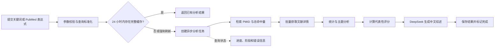

# PubMed 科研情报分析 Demo — 需求文档

| 项目 | 内容 |
| --- | --- |
| 文档版本 | v1.0 |
| 文档日期 | 2026-10-12 |
| 当前阶段 | 后端 MVP，前端暂不实施 |
| 技术约束 | FastAPI、PostgreSQL、DeepSeek、NCBI PubMed E-utilities |

## 1. 产品概述

本项目是一个面向科研人员、医学从业者和研发决策人员的 PubMed 文献情报分析 Demo。调用方输入医学关键词或完整 PubMed 检索表达式后，系统从 PubMed 获取真实文献数据，生成年度趋势、作者单位国家/地区分布、主题词云、研究方向、近五年代表性文献 Top 100，以及一份有文献证据支撑的中文综述。

本阶段只交付可独立运行、可通过 Swagger 调用的后端 API。前端交互与视觉方案在后端完成并通过验收后另行设计。

## 2. 背景与关键约束

原始任务中“影响因子前 100 文献”存在口径问题：

- PubMed 不提供 Journal Impact Factor（JIF）。
- JIF 是期刊级指标，不是论文级指标。
- PubMed 的引用关系来自其可见数据源，覆盖并不完整。

因此，本项目将该能力定义为“近五年代表性文献 Top 100”，采用透明、可解释的综合评分，不宣称该评分等同于影响因子或完整引用影响力。若未来需要正式 JIF，必须接入合法授权的数据源，并按 ISSN 和指标年份匹配。

## 3. 产品目标

### 3.1 首期目标

1. 支持真实 PubMed 检索和数据同步。
2. 将长耗时分析封装为可恢复、可查询进度的异步任务。
3. 输出可解释、可追溯的统计与研究方向分析。
4. 使用 DeepSeek 生成 500–800 个中文字符的证据约束综述。
5. 为相同检索提供缓存复用，保证现场演示稳定。
6. 提供完整 OpenAPI 文档、容器化运行方式和自动化测试。

### 3.2 成功标准

- 新建分析请求在 1 秒内返回 `202 Accepted` 和 `analysis_id`。
- 默认规模的新分析在正常外部服务条件下目标 3 分钟内完成。
- 24 小时内相同参数的缓存结果目标 1 秒内返回。
- 所有统计结果都包含样本量、数据获取时间和计算口径。
- AI 报告的关键结论包含支撑 PMID，且不引入输入证据之外的数字或事实。
- PubMed 或 DeepSeek 临时不可用时，系统给出可诊断状态或明确降级结果，而不是静默产生伪造数据。

## 4. 用户角色

### 4.1 API 调用者

通过 Swagger、脚本或未来前端创建分析、查看进度、读取结果、取消或重试任务。

### 4.2 演示者

使用预设关键词展示系统能力，需要稳定、快速，并能解释每项指标的来源和限制。

### 4.3 运维/开发人员

配置外部服务密钥、查看日志和健康状态、执行数据库迁移、排查失败任务。

首期不建设终端用户账号、登录、多租户和角色权限系统。

## 5. 术语与统计口径

| 术语 | 定义 |
| --- | --- |
| 总命中量 | PubMed `ESearch` 返回的 `Count`，不代表系统已抓取全部记录 |
| 分析样本 | 本次实际抓取并用于统计的文献集合，默认最多 2,000 条元数据 |
| 摘要样本 | 用于主题和语义分析的有摘要文献，默认最多 500 篇 |
| 报告证据集 | 交给 DeepSeek 的精选文献，默认 30–50 篇 |
| 第一作者国家/地区 | 从第一作者单位自由文本中推断的国家/地区，不等同于研究发生地 |
| PubMed 可见被引数 | 通过 PubMed/NCBI 可见引用关系计算的数量，覆盖不完整 |
| 代表性评分 | 本系统内部的可解释综合评分，不是 JIF |
| Query Translation | PubMed 自动词语映射后实际执行的检索表达式 |

## 6. 核心用户流程



## 7. 功能需求

### FR-01 创建分析

调用方提交：

- `query`：必填，支持普通关键词和完整 PubMed 检索语法。
- `start_year`、`end_year`：可选。
- `languages`：可选。
- `publication_types`：可选。
- `sort`：默认相关度，可选发表时间。
- `force_refresh`：默认 `false`。
- `metadata_limit`：默认 2,000，服务端设定安全上限。
- `abstract_limit`：默认 500，且不得大于元数据上限。
- `report_evidence_limit`：默认 40，允许范围 30–50。

系统必须标准化参数并计算查询哈希。无可复用缓存时返回 `202 Accepted`；缓存命中时可返回 `200 OK` 并标记 `cache_hit=true`。

### FR-02 PubMed 检索

系统使用 `ESearch`：

- 保存总命中量、返回 PMID 列表和 `QueryTranslation`。
- 展示总命中量时同时返回实际分析样本量。
- 支持日期、语言和文献类型筛选。
- 单次分析只获取配置上限内的记录，不暗示覆盖全部命中结果。
- 对超过 PubMed 可直接获取边界的大结果集，首期只做限量采样；未来全量模式可按日期切片。

### FR-03 文献详情同步

系统使用 `EFetch` 批量获取并规范化以下数据：

- PMID、标题、摘要、作者、作者顺序、ORCID（若有）。
- 作者单位原文。
- 期刊、ISSN、卷期页、语言和发表日期。
- DOI、PMCID 等外部标识。
- Publication Type、MeSH、作者关键词。
- 更正、撤稿或关联记录（若返回）。

所有上游可缺失字段必须允许为空，不得用虚构默认值补齐。

### FR-04 年度统计

- 依据规范化发表日期按年份计数。
- 返回年份、文献数和占样本比例。
- 日期无法解析的记录归入 `unknown_count`。
- 返回统计采用的样本量。

### FR-05 国家/地区统计

- 默认从第一作者首个单位地址推断国家/地区。
- 保存单位原文、标准化国家代码、解析规则版本和置信度。
- 无法判断时归入“未知”，不得强行猜测。
- API 明确返回 `method=first_author_affiliation` 和口径说明。

### FR-06 主题词云

词频权重默认采用：

- Major MeSH：3。
- 普通 MeSH：2。
- 作者关键词：1。
- 对缺少 MeSH/关键词的文献，使用标题和摘要术语作为补充来源。

系统应过滤停用词、规范化大小写和词形、合并已知同义词，至少返回 Top 20 主题、频次、加权分数和来源构成。

### FR-07 研究方向

- 优先根据 MeSH 共现网络生成 5–8 个主题簇。
- MeSH 覆盖不足时回退到标题/摘要 TF-IDF 聚类。
- 每个主题簇返回代表术语、文献数量、代表 PMID 和算法置信信息。
- DeepSeek 只能基于算法结果生成中文主题名称和总结，不负责凭空分组。

### FR-08 代表性文献 Top 100

候选集限定为当前日期向前五年内的分析样本文献。默认评分为：

```text
代表性评分 =
40% PubMed 相关度
+ 20% PubMed 可见被引数百分位
+ 15% 发表时间
+ 15% 文献类型
+ 10% MeSH 主题匹配度
```

要求：

- 各分项归一化到统一范围，并返回分项分数。
- 被引信息缺失表示“未知”，不得直接解释为零引用。
- 缺失分项时按剩余有效权重重新归一化。
- 评分算法必须带版本号，便于结果复现。
- 返回最多 100 篇，支持分页。
- API 和未来 UI 都必须说明该排名不是正式影响因子排名。

### FR-09 中文综述报告

报告正文目标为 500–800 个中文字符，不包含参考 PMID 列表。固定结构：

1. 领域概况。
2. 年度趋势。
3. 主要研究方向。
4. 代表性发现。
5. 局限与趋势。

每个章节必须返回支撑该结论的 PMID 列表。发送给 DeepSeek 的内容限于 PMID、标题、必要摘要片段、MeSH 和统计结果，不发送作者联系方式或密钥。

DeepSeek 输出必须经过 Pydantic Schema 校验。空响应、截断或格式错误允许一次格式修复/有限重试；最终失败时生成模板报告，并设置：

```json
{
  "generation_mode": "template_fallback",
  "ai_status": "degraded"
}
```

所有报告返回“AI 辅助生成，不构成医疗建议”的提示。

### FR-10 任务状态与进度

调用方可查询：

- 总状态：`queued`、`running`、`succeeded`、`failed`、`cancel_requested`、`cancelled`。
- 当前阶段：检索、抓取、解析、丰富、统计、主题分析、排名、报告生成、持久化。
- 整体进度百分比。
- 已处理数量和计划处理数量。
- 对外错误码、可读错误信息、是否可重试。

任务支持取消和失败后重试。服务重启后，未完成任务必须能够重新排队或从安全检查点恢复。

### FR-11 历史记录与缓存

- 24 小时内相同标准化参数默认复用已完成结果。
- `force_refresh=true` 可创建新分析。
- 支持分页查询历史分析。
- 支持软删除分析及其专属结果。
- 被其他分析复用的公共文献缓存不得随单次分析删除。

### FR-12 健康检查与接口文档

- `GET /health/live`：进程存活。
- `GET /health/ready`：数据库可用且必要配置完整。
- Demo 环境开放 `/docs` 和 `/openapi.json`。
- OpenAPI 必须描述错误响应、分页结构和枚举值。

## 8. 非功能需求

### NFR-01 性能与容量

- 创建任务接口目标小于 1 秒。
- 完整缓存命中目标小于 1 秒。
- 默认分析规模：最多 2,000 条元数据、500 篇摘要、40 篇报告证据。
- 正常外部服务条件下，新分析目标 3 分钟内完成。
- PubMed 客户端使用批量请求，并在带密钥时将应用级上限设置为每秒 8 次请求，为官方限制保留余量。

### NFR-02 可靠性

- 外部请求设置连接和读取超时。
- 仅对超时、限流和服务端错误执行指数退避与随机抖动。
- 认证、余额、参数错误不得盲目重试。
- 每个阶段应具有幂等性，重复执行不得制造重复文献和重复结果。

### NFR-03 安全

- `NCBI_API_KEY`、`DEEPSEEK_API_KEY` 只从服务端环境变量读取。
- 日志、数据库、错误响应和 OpenAPI 示例不得出现真实密钥。
- 首期默认只监听本机；可选启用 `X-API-Key` 服务鉴权。
- CORS 使用允许列表，不允许携带凭据的通配来源。
- 对查询长度、批量上限和分页大小进行服务端限制。

### NFR-04 可观测性

- 使用 JSON 结构化日志和贯穿请求/任务的 `correlation_id`。
- 记录各阶段耗时、外部请求次数、重试次数、缓存命中和 DeepSeek token 用量。
- 不记录完整密钥、完整摘要集合或 DeepSeek 原始提示词。

### NFR-05 可维护性

- 使用类型标注、Pydantic 模型、SQLAlchemy 2.x 和 Alembic。
- 业务逻辑与 FastAPI 路由、外部客户端和 ORM 模型解耦。
- 排名、国家解析、主题算法和提示词均有独立版本号。

## 9. API 首期范围

| 方法 | 路径 | 用途 |
| --- | --- | --- |
| POST | `/api/v1/analyses` | 创建或复用分析 |
| GET | `/api/v1/analyses` | 分页查询历史分析 |
| GET | `/api/v1/analyses/{id}` | 查询状态和摘要信息 |
| POST | `/api/v1/analyses/{id}/cancel` | 请求取消任务 |
| POST | `/api/v1/analyses/{id}/retry` | 重试可恢复失败 |
| DELETE | `/api/v1/analyses/{id}` | 软删除分析 |
| GET | `/api/v1/analyses/{id}/overview` | 获取总览和统计口径 |
| GET | `/api/v1/analyses/{id}/trends` | 获取年度趋势 |
| GET | `/api/v1/analyses/{id}/regions` | 获取国家/地区统计 |
| GET | `/api/v1/analyses/{id}/topics` | 获取词云和研究方向 |
| GET | `/api/v1/analyses/{id}/publications` | 获取代表性文献列表 |
| GET | `/api/v1/analyses/{id}/report` | 获取中文综述 |
| GET | `/health/live` | 存活检查 |
| GET | `/health/ready` | 就绪检查 |

## 10. 明确不在首期范围内

- 前端页面和视觉设计。
- 用户注册、登录、组织和多租户。
- 正式 Journal Impact Factor、Scopus 或 Web of Science 指标。
- 对全部 PubMed 命中结果进行全量离线分析。
- 医疗诊断、治疗建议或临床决策支持。
- PDF 全文抓取、付费全文解析。
- 人工编辑报告、多人协作和分享链接。
- PDF/Word 导出；首期 API 返回 JSON 和可渲染 Markdown。

## 11. 验收标准

### AC-01 正常分析

给定一个可检索到文献的医学关键词，创建请求返回分析 ID；任务最终成功，并能分别读取年度、地区、主题、代表性文献和报告结果。

### AC-02 数据透明度

结果必须同时显示总命中量、分析样本量、摘要样本量、实际检索表达式和获取时间。

### AC-03 缓存复用

24 小时内以相同参数再次请求时复用已完成结果；传入 `force_refresh=true` 时创建新分析。

### AC-04 缺失数据

遇到无摘要、无 MeSH、无单位或不完整日期的记录时任务仍可完成，结果正确计入未知项。

### AC-05 排名可解释

每篇代表性文献返回总分、有效权重、各分项得分、评分版本和引用覆盖提示。

### AC-06 报告可追溯

每个报告章节至少包含一个有效 PMID，或明确标记“证据不足”；报告不得出现证据集中不存在的精确统计数字。

### AC-07 外部服务降级

DeepSeek 不可用时，文献统计仍然可读取，报告以模板方式生成并明确标记降级；PubMed 不可用时任务失败且返回可重试错误，不生成伪数据。

### AC-08 任务恢复

在任务执行中重启服务，任务可依据租约和检查点重新排队，不永久停留在 `running`。

### AC-09 安全检查

代码、数据库、日志、API 响应和文档中均不存在真实 NCBI 或 DeepSeek 密钥。

### AC-10 自动化测试

单元测试覆盖查询标准化、评分、国家解析和输出校验；集成测试覆盖数据库、任务状态流转和外部客户端 Mock；提供至少一个端到端 API 测试场景。

## 12. Demo 建议数据

为现场演示准备三个稳定但不写死结果的示例：

- `Alzheimer disease biomarkers`
- `CAR-T therapy solid tumors`
- `Type 2 diabetes digital health`

示例只用于快速填充请求参数，实际结果始终来自 PubMed 或明确标注的缓存快照。

## 13. 风险与应对

| 风险 | 影响 | 应对 |
| --- | --- | --- |
| PubMed 网络波动或限流 | 任务超时 | 批量获取、8 req/s 限速、重试、24 小时缓存 |
| DeepSeek 响应慢或格式异常 | 报告失败 | JSON Schema 校验、有限重试、模板降级 |
| 影响力概念被误解 | 产品可信度受损 | 使用“代表性评分”，展示公式和限制 |
| 单位地址无法准确解析国家 | 地区统计偏差 | 保留原文、置信度、未知分类和方法说明 |
| 新文献尚无 MeSH | 主题覆盖不足 | 标题/摘要 TF-IDF 回退 |
| AI 产生无依据结论 | 错误信息 | 精选证据集、PMID 引用、结构化校验和后校验 |
| 现场重复调用造成费用和延迟 | 演示不稳定 | 查询缓存、任务幂等和应用级并发限制 |

## 14. 外部依据

- [NCBI E-utilities Quick Start](https://www.ncbi.nlm.nih.gov/books/NBK25500/)
- [NCBI E-utilities 使用说明](https://www.ncbi.nlm.nih.gov/books/NBK25499/)
- [NCBI API Key 与账户说明](https://www.ncbi.nlm.nih.gov/books/NBK53593/)
- [PubMed 数据字段说明](https://pubmed.ncbi.nlm.nih.gov/help/#pubmed-data-field-descriptions)
- [PubMed Cited by 完整性说明](https://pubmed.ncbi.nlm.nih.gov/help/#cited-by)
- [DeepSeek API 文档](https://api-docs.deepseek.com/)
- [DeepSeek JSON Output](https://api-docs.deepseek.com/guides/json_mode/)
- [DeepSeek 错误码](https://api-docs.deepseek.com/quick_start/error_codes/)

